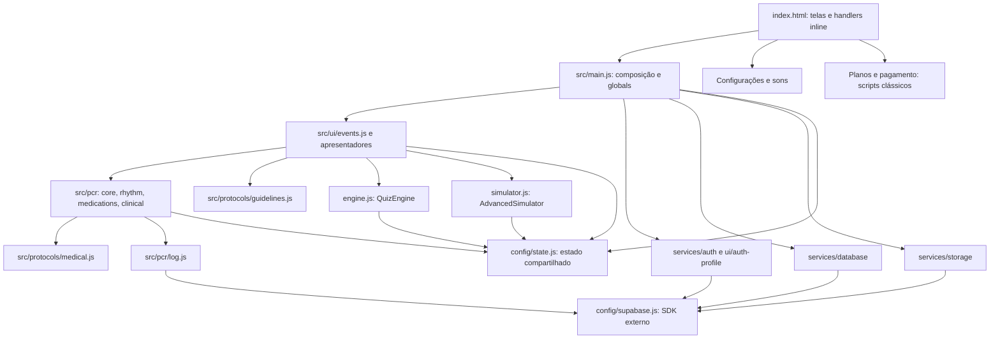

# SIAV — Arquitetura Oficial 1.0

**SIAV: Suporte Inteligente de Assistência à Vida.**

Documento de diagnóstico e direção arquitetural, elaborado em 10/11/2026. A denominação oficial acima vem da visão de produto desta entrega; o código ainda usa variações de “Sistema Inteligente” e o README usa outra expansão. Nenhuma nomenclatura da interface foi alterada.

- Repositório: `jhcruzdomingues/SIAV`.
- Branch: `fix/adult-pcr-antiarrhythmics`; PR #2.
- Base auditada: `02b83bead5ba52e6cd8c6a08084e0f174f4b6cf7`, incluindo a Entrega 1 mobile.
- Escopo: análise e documentação. Este documento não implementa a arquitetura proposta e não aprova o produto para uso clínico.
- Inventário da base: **114 arquivos versionados**, sendo 98 textuais e 16 binários. Com a inclusão deste documento, serão **115**. A contagem anterior de 113 precedia o teste mobile adicionado na Entrega 1.

## 1. Resumo executivo

O SIAV já tem uma aplicação web em JavaScript com suporte operacional à PCR, autenticação, conteúdo educacional, questões, simulador ramificado e indicadores básicos. Não é necessário reescrever tudo para construir os quatro pilares. A evolução recomendada é separar gradualmente responsabilidades e contratos, preservando os comportamentos cobertos por testes.

O pilar Assistência é o mais desenvolvido: há estado de PCR/ROSC, episódios, orientação adulta, registro explícito de medicamentos, decisão consumível de choque, cronômetros e relatório. Isso não equivale a validação clínica integral, persistência durável ou suporte PALS completo. Simulação já oferece decisões que encaminham a diferentes etapas de um caso; não foi encontrado um motor fisiológico contínuo. Academy tem questões e conteúdo HTML; Performance tem agregações parciais, sem acompanhamento longitudinal de competências ou recomendações individualizadas de estudo.

Os bloqueios mais urgentes são: estabilidade em Safari real; revisão clínica dos caminhos ainda não homologados; integridade entre atendimentos; persistência estruturada e isolamento de usuário da fila offline; segurança de renderização; e correspondência entre o artefato produzido, o schema versionado e os contratos usados pelo frontend. A aprovação de 130 testes não cobre esses bloqueios por completo.

**Direção 1.0 proposta:** um frontend modular por domínio, com núcleo clínico determinístico, serviços de aplicação, adaptadores de persistência e apresentação separados. Assistência, Simulação e Academy terão estados e dados distintos; Performance produzirá projeções com origem explícita, sem transformar dados simulados em registros assistenciais reais.

## 2. Método, evidências e limites

### 2.1 Classificação das conclusões

- **V — verificado no código:** estrutura, chamadas, campos ou comportamento explicitamente encontrados na base.
- **R — reproduzido localmente:** testes/build ou sondas isoladas com dados sintéticos, sem chamada ao backend.
- **I — inferência/risco:** consequência possível da implementação; não significa incidente confirmado.
- **P — proposta futura:** contrato, entidade, módulo ou processo que ainda precisa ser implementado e aceito.
- **NV — não verificado:** implantação, conteúdo e políticas efetivas do backend, pagamentos reais, homologação clínica e condições de uso em produção.

Os 114 arquivos foram inventariados. A revisão textual cobriu entradas, módulos, configurações, documentação, testes e folhas de estilo, com rastreamento de importações, chamadas globais, armazenamento, acesso remoto e referências de assets. Os 15 arquivos de áudio tiveram formato/metadados inspecionados; seu conteúdo sonoro não foi homologado. O outro binário é um pacote VSIX de aproximadamente 15,1 MB, identificado pelo manifesto interno como extensão GitHub Copilot Chat; não foi executado. Arquivos vazios, duplicados e artefatos sem ligação à entrada principal também constam do inventário.

Não foram feitas consultas ao banco, testes com pacientes reais, login real, leitura de dados pessoais remotos, alteração de RLS, migração, deploy ou merge. O SQL local é evidência do que o repositório declara, **não do que está instalado no Supabase**. Não foram copiados valores de chaves para este documento.

### 2.2 Verificações desta auditoria

| Verificação | Resultado | Limite da evidência |
|---|---|---|
| Branch/HEAD versus GitHub | Base local e remota iguais a `02b83be` antes da documentação | Não inspeciona produção |
| `git ls-files` e leitura dos arquivos | 114 arquivos acessíveis; 98 textos e 16 binários | Não equivale a teste funcional de cada arquivo |
| `npm run test:run` | **130 testes em 11 arquivos, aprovados** | Predominam testes locais/Vitest/jsdom; sem prova de RLS, pagamentos ou eficácia clínica |
| `npm run build` | Concluído | Warnings de quatro scripts legados e CSS; saída incompleta em assets |
| Inspeção de `dist/index.html` e arquivos de saída | Quatro scripts referenciados e ausentes; faltam também SW, fallback do quiz, áudios e páginas secundárias examinadas | Defeito do empacotamento local; não descreve o conteúdo do host de produção |
| Sonda sintética de novo atendimento | `state.notes` continua contendo a nota do atendimento anterior | Vazamento de estado reproduzido; não prova que um paciente real foi afetado |
| Sonda de utilitário pediátrico | `calculateDose('sulfato', 20)` retorna `500.00 g (25 g/kg)`; outro helper retorna `{ value: 500, unit: 'g' }` | Inconsistência matemática/unidade no utilitário; não é uma recomendação clínica. O modal ativo não utiliza esse helper para sugerir automaticamente magnésio |
| Inspeção DOM do perfil | `profile-update-form` é `DIV`, dentro de `login-form` | Contrato incompatível com listener de submit; exige correção própria |
| Base educacional local | 20 questões: 4 SBV, 11 ACLS, 5 PALS | Sem auditoria científica item a item |

A Entrega 1 já incluiu validação de interação em Chromium emulando iPhone 13 e SE, com arquivos reais do CDN obtidos por transporte com TLS verificado. Isso é evidência anterior da sessão, não homologação de Safari/iOS físico. A tentativa posterior de abrir o navegador compartilhado falhou com `Browser Use could not read requirements`. Não há preview público fornecido nesta auditoria.

## 3. Estado funcional por pilar

“Existente” significa implementação identificada; “parcial” significa que parte do fluxo existe; “quebrado” abaixo identifica um contrato ou comportamento local concretamente inconsistente. Nenhuma promessa de README, cartão comercial ou comentário foi tratada como funcionalidade entregue.

| Pilar / capacidade | Estado | Evidência e lacuna |
|---|---|---|
| Assistência — início, paciente e navegação PCR | Existente, com pendências | `src/ui/patient.js`, `src/ui/events.js`, `src/pcr/core.js`; início sem dados e confirmação de algoritmo adulto. Falta reinicialização integral por atendimento |
| Assistência — PCR adulta, ROSC e recorrência | Existente, com regressões | `clinical.js`, `core.js`, `rhythm.js`, `medical.js`; episódios e passos separados de contagem total de choques. Ver `REVIEW_ADULT_PCR_STAGE2.md` |
| Assistência — seleção de ritmo mobile | Existente na Entrega 1 | Primeiro toque seleciona; botão explícito confirma; seleção pode mudar; operação consumida impede repetição imediata |
| Assistência — medicamentos | Existente no percurso adulto, parcial no restante | Quantidade/unidade/via/horários explícitos, histórico incerto pede reavaliação; fontes legadas de dose e conteúdo continuam divergentes |
| Assistência — desfibrilação e pediatria | Parcial, sem homologação integral | Energia preexistente e cálculos por idade/peso; não há máquina clínica PALS específica aprovada no código |
| Assistência — tempo, som, sinais vitais e Glasgow | Existente, com riscos | Intervalos na thread principal; sinais vitais viram texto na timeline; áudio e preferência têm contratos divergentes |
| Assistência — relatório e histórico | Parcial/inconsistente | HTML gerado e CRUD remoto existem; payloads/schema/mapeamentos divergem; sem trilha imutável, assinatura ou comprovação de validade jurídica |
| Assistência — operação offline e recuperação | Parcial/quebrada em casos importantes | IndexedDB e fallback existem; sem isolamento de proprietário na fila, sem idempotência remota comprovada, sem snapshot durável ativo do atendimento; assets offline ausentes |
| Simulação — casos virtuais e escolhas | Existente como grafo discreto | `simulator.js` segue `next_step` do `game_flow`; sinais do monitor vêm da etapa; escolhas podem alterar o percurso |
| Simulação — evolução fisiológica contínua | Proposta futura | Não foram encontrados integrador fisiológico, evolução temporal autônoma ou modelo validado de resposta a intervenções |
| Simulação — avaliação e persistência | Parcial | Pontos, tentativas e duração existem; nota soma máximos de todas as etapas, não necessariamente só do percurso. `attempts` é array no código e integer no SQL |
| Simulação — limites de uso | Parcial/inconsistente | Consulta contagem de logs concluídos; não reserva/incrementa uso atomicamente; anônimo ou falha de rede tende a contagem zero |
| Academy — banco de questões | Existente/parcial | `engine.js`, tabela remota referenciada `quiz_questions`, fallback local. Sem schema dessa tabela no SQL versionado |
| Academy — resumos e protocolos BLS/ACLS/PALS | Existente como conteúdo estático parcial | `guidelines.js`: guias ECG/farmacologia/5H5T, protocolos adulto/pediátrico/AVC/IAM; falta revisão editorial e clínica abrangente/versionada |
| Academy — fluxogramas interativos completos | Parcial/proposta | HTML de fluxogramas e expansão de causas existem; não há motor completo de navegação por nós, proveniência e progresso para BLS/ACLS/PALS |
| Academy — PDF | Parcial | Abre impressão do navegador para “Salvar como PDF”; não é serviço de geração/exportação clínica estruturada |
| Performance — indicadores atuais | Existente/parcial | Dashboard usa logs PCR e média de quizzes locais; `loadUserStats` e `loadSimulationLogs` estão expostos, mas não compõem uma visão integrada na UI |
| Performance — evolução individual e dificuldades | Proposta futura | Resultados de quiz não têm respostas por item, competências, data e versão suficientes; não há modelo longitudinal implementado |
| Performance — recomendações de estudo | Proposta futura | Mensagens gerais por faixa de pontuação não são recomendações individuais baseadas em lacunas |
| Compartilhado — autenticação/perfil | Existente, com contratos duplicados | `services/auth.js` e `ui/auth-profile.js`; abertura de login corrigida na Entrega 1; atualização de perfil e estado de sessão ainda exigem auditoria funcional |
| Compartilhado — planos/pagamentos/certificados | Parcial/protótipo | Fluxo do modal ativo mostra “CHECKOUT SIMULADO”; existe outro cliente de Edge Function, sem validação end-to-end. Certificado é benefício anunciado, não pipeline encontrado |
| Compartilhado — analytics/i18n/acessibilidade/PWA | Parcial | Infraestrutura existe; traduções parciais, foco/ESC procuram `display: block` enquanto modais usam flex; consentimento analytics assume true; PWA com assets faltantes |

## 4. Arquitetura JavaScript atual

### 4.1 Entradas e fluxo real

`index.html` é a única entrada configurada no build Vite. Contém telas, formulários, modais, conteúdo e handlers inline. Carrega `src/main.js`, `settings-integration.js` e `sound-settings.js` como módulos; quatro scripts comerciais/legados continuam clássicos. `script.js` contém somente aviso de migração, não o antigo monólito descrito no README.

`src/main.js` é o ponto de composição: inicializa DOM, áudio, i18n, analytics, acessibilidade e configurações, registra eventos antes da espera de sessão, consulta sessão/perfil, instala listener de autenticação e expõe funções no objeto `window.SIAV` e diretamente em `window`. Quiz e simulador são carregados dinamicamente. O registro do Service Worker ocorre depois das esperas assíncronas, via listener de `load`; se o evento já passou, esse registro pode ser perdido.



As setas resumem dependências; não implicam exclusividade. Há comunicação adicional por `window`, DOM e event bus. O grafo de imports locais examinado não evidenciou ciclos estáticos, mas callbacks globais criam dependências bidirecionais em tempo de execução, invisíveis a esse grafo.

### 4.2 Mapa de módulos e acoplamentos

| Área atual | Responsabilidade efetiva | Acoplamento / oportunidade |
|---|---|---|
| `src/config/state.js` | Estado de usuário, paciente, PCR, quiz, histórico, áudio e UI | Objeto mutável compartilhado com `window`; `pcrSeconds` e `pcrElapsedSeconds`, `events` e `timeline`, `user` e `currentUser` coexistem |
| `src/pcr/clinical.js` | Transições, episódio e decisão de choque consumível | Bom candidato a núcleo; ainda lê/escreve singleton e `compressionCycle` |
| `src/protocols/medical.js` | Funções de orientação, elegibilidade, energia e Glasgow | Parte recebe snapshot/tempo explicitamente; preservar essa interface e seus testes; energia e regras pediátricas precisam revisão própria |
| `src/pcr/core.js` | Ciclo, tempo, início/fim/ROSC recorrente | Mistura domínio, timers, DOM, áudio global, confirmação e relatório |
| `rhythm.js`, `medications.js`, `vitals.js`, `log.js` | Interação, comando e registro | Misturam formulário, regra, mutação, renderização e, em `log`, Supabase direto |
| `src/ui/events.js` | Registro central dos listeners | Conhece quase todos os domínios, monetização e simulador; precisa lifecycle/desinscrição e escopo por tela |
| `src/ui/auth-profile.js` | Auth, perfil, planos e dashboard | Duplica serviços, conhece histórico assistencial e renderiza HTML com dados de perfil |
| `src/services/database.js` | Perfis, PCR, estatísticas, casos e simulações | Repositório genérico dependente de estado global; contratos PCR duplicam `pcr/log.js` |
| `src/services/storage.js` | Preferências, fila offline, limites de planos | “Local” importa SDK remoto para contagem de simulações; áudio, i18n e analytics herdam essa dependência |
| `engine.js` | Quiz: busca, fallback, renderização, resposta e score | Recebe dependências no construtor, mas usa DOM/globals; resultado sem rastreabilidade por questão |
| `simulator.js` | Caso ramificado, monitor, escolhas, pontuação e tela | `simulationState` próprio é positivo; usa `state` comum para identidade/plano e grava por `window.SIAV` |
| `guidelines.js` + `utils/medications.js` | Conteúdo, recomendações de causas e cálculos | Fontes clínicas distintas do avaliador central, com critérios e textos potencialmente divergentes |
| `src/ui/dom.js` | Navegação e modais ativos | Fonte operacional atual; `src/ui/navigation.js` contém outra implementação sem integração à entrada |
| `src/ui/audio.js` + `sound-settings.js` | Metrônomo/sons e configuração/importação de áudio | Dois modelos de configuração e chaves diferentes; handlers usam tipos maiúsculos que não correspondem ao mapa minúsculo de `playNotification` |
| `src/utils/events.js` | Pub/sub simples | Não tem unsubscribe, isolamento de erros ou namespace por domínio |
| Scripts de planos/pagamento | UI comercial, preços e outro checkout | Preços, nomes de plano e período divergem; dependência de globals e de scripts não empacotados |
| Build, CI, PWA | Vite, Vitest, Actions, cache | Contratos de pasta e lockfile inconsistentes; manifesto/SW não garantem offline funcional |

### 4.3 Código paralelo e fronteiras frágeis

- `src/pcr/start.js` oferece outro `startPCR` e um `startSimulation` com TODO e chamada assíncrona de limite sem `await`. Não é o caminho acionado por `src/main.js`; não contar como implementação funcional de simulação.
- `src/pcr/timer.js` e `src/workers/pcr-worker.js` contêm Worker/Wake Lock, mas não são usados pelo `core.js` ativo. A existência desses arquivos não significa cronômetro ativo resistente a suspensão iOS; o próprio Worker também incrementa por intervalos.
- `src/pcr/cycle.js` mantém outro objeto de ciclo; `src/ui/navigation.js` outra navegação. Não migrar para eles sem comparação de comportamento.
- `src/index.js` reexporta `config` de `config/supabase.js`, que não o exporta; o barrel não é usado pela entrada principal. Risco de falha se um consumidor passar a importá-lo.
- `plans-modal-optimized.js` e `plans-modal-optimized-v5.js` têm conteúdo idêntico na base; só o segundo é carregado pelo HTML.
- `tests/setup.js` existe, mas não está em `test.setupFiles` de `vite.config.js`; seus mocks não representam configuração global efetiva.
- `README.md`, checklist e arquivo de “backup excluído” contêm afirmações históricas, caminhos ausentes e listas de arquivos que ainda estão versionados. Não são critérios de aceitação atuais.

Critérios clínicos divergentes concretos: `getShockRecommendation` considera pediátrico por idade `< 8` ou peso `< 30`, `isPediatric` em formatters e os tratamentos de causas usam idade `< 18`, e `calculateDose` usa peso `< 50` para o cálculo pediátrico. Energia também usa defaults de idade/peso quando a entrada não é numérica. O avaliador de medicamentos adulto, por outro lado, exige `patient.algorithm === 'adult'`. Esses contratos não são equivalentes; esta auditoria não escolhe um novo corte clínico nem corrige doses. A próxima revisão deve definir explicitamente população, contexto, dados desconhecidos e fonte aprovada por função.

## 5. Dados e dependências do Supabase

### 5.1 Armazenamento observado

| Meio | Dados / chaves observadas | Limites atuais |
|---|---|---|
| Memória | `state.patient`, `clinical`, `shocks`, `medications`, `events`, `notes`, `quiz`, `quizResults`, `patientLog`; `simulationState` | Sem checkpoint ativo durável do atendimento; reload perde estado; notas não são limpas por `core.startPCR` |
| `localStorage` com prefixo `siav_` | Preferências `settings`, `locale`, `analytics_consent`; fallback `offline_logs`; auxiliares `daily_usage`, `saved_patients` | Nem todas as funções de limites/contadores são usadas pelo fluxo ativo; sem segregação consistente por usuário |
| `localStorage` legado | `siavState` com `quizResults`, `siav_theme`, `siav_sound_settings`, `siavRememberLogin`; dados comerciais e de retorno | Múltiplas convenções, quiz sem proprietário; `loadState` exportado mas não chamado pelo bootstrap; exportador de configurações lê chaves diferentes das usadas pelos gravadores ativos |
| IndexedDB `SiavAppDB`, store `appStore` | Array `offline_logs` | Sem chave de proprietário/domínio; read-modify-write do array permite perda concorrente; timestamp como ID pode colidir; confirmação do request não espera explicitamente `transaction.oncomplete` |
| IndexedDB de áudio | `SiavSoundsDB` / `audioStore` em `sound-settings.js` | Sons customizados e carga local; sem vínculo com logs clínicos, mas devem ter limites e validação de arquivo |
| Cache API / SW | Shell e respostas de origem; tentativa de precache | Assets declarados não existem; `cache.addAll` pode falhar; SDK externo não faz parte de um pacote offline completo |
| Supabase Auth | Sessão, login/cadastro, atualização de email/senha | Dois serviços/estados; sucesso/erro efetivo e políticas do serviço não verificados |
| Tabelas remotas referenciadas | `profiles`, `pcr_logs`, `simulation_logs`, `clinical_cases`, `quiz_questions` | As quatro primeiras têm definição local parcial; `quiz_questions` não tem definição no SQL versionado |
| Edge Functions referenciadas | `mercadopago-checkout`, `mercadopago-verify` | Somente checkout tem fonte versionada; implantação e verificação de pagamento NV |

### 5.2 Quais módulos dependem do Supabase

- **Cliente/configuração:** `src/config/supabase.js`, importado por `src/main.js` e reexportado pelo barrel não utilizado `src/index.js`.
- **Acesso direto por import:** `src/services/auth.js`, `database.js`, `storage.js`, `src/ui/auth-profile.js`, `src/pcr/log.js`.
- **Cliente injetado:** `engine.js` recebe `supabase` e consulta `quiz_questions`.
- **Acesso via global/fachada:** `simulator.js` usa `window.SIAV.saveSimulationLog`/`fetchRandomClinicalCase`; `mercadopago-integration.js` invoca funções por `window.SIAV.supabase` e fallbacks.
- **Backend versionado:** `supabase/functions/mercadopago-checkout/index.ts` usa segredo de ambiente e API Mercado Pago; não usa um cliente de banco no arquivo examinado. Não foi executado.
- **Dependência transitiva evitável:** áudio, i18n e analytics importam o serviço de storage que importa o SDK; UI depende de globals registrados pelo bootstrap que também depende do SDK. Bloqueio de CDN pode impedir inicialização de funções que seriam locais.

O SDK é importado de CDN em `config/supabase.js`; o HTML ainda carrega outra forma do SDK. Não há pacote Supabase fixado no `package.json`. A URL e a chave publishable estão no código; isso não equivale a vazamento de chave `service_role`, mas acopla ambientes. `.env.example` não é consumido por esse módulo. A configuração de exemplo do segredo de pagamento tem nome diferente do segredo lido pela Edge Function. Nada foi alterado nesta auditoria.

### 5.3 Divergências contratuais verificadas

1. `pcr/log.js` insere `duration_seconds`, `rhythm`, `patient_age`, `timeline`, `report_html`, `drugs_administered` e muitos outros campos. O SQL local define apenas um subconjunto, incluindo `duration` e `initial_rhythm`. `services/database.js` trabalha com outro contrato de PCR.
2. O leitor `fetchPcrLogs` usa `shocks_count`, enquanto o gravador e o SQL usam `shock_count`; médias podem virar `NaN` ou exibir zero indevido. Os dois caminhos de duração também divergem.
3. `generateEvolution` monta um `logEntry` reduzido. Não encaminha como campos estruturados boa parte de paciente, eventos e medicações disponíveis em memória; `notes` recebe HTML do relatório. O texto renderizado não substitui persistência tipada de dose, via, horários, episódio e proveniência.
4. `simulationData.attempts` é array; `simulation_logs.attempts` no SQL é integer. Não foi validado contra o banco remoto.
5. Perfil lê/escreve `phone_number` e `birth_date`, ausentes no SQL local.
6. `saveSimulationLog` devolve `success: true, id: null` sem persistir quando `state.user` não existe. A UI pode informar salvamento sem registro durável.
7. `state.user` abastece `database.js`, mas login/logout da UI atualizam principalmente `state.currentUser`. O listener de UI não sincroniza o primeiro; `services/auth.onAuthStateChange` é importado, mas não instalado pelo bootstrap. Há risco de gravação não feita após login e referência de usuário antigo após logout.
8. A fila offline não guarda envelope de domínio/proprietário. A sincronização usa o usuário corrente e `savePCRLog` faz `{ user_id: state.user.id, ...pcrData }`: um `user_id` dentro do payload sobrescreve o prefixo. A presença de RLS não corrige sozinha a origem local mal definida.
9. `markLogSynced` localiza no IndexedDB por ID, mas só marca o fallback localStorage quando recebe índice numérico. O sincronizador prefere o ID string; registros do fallback podem ser reenviados indefinidamente. Metadados locais também seguem no objeto enviado ao insert, sem DTO estrito.

## 6. Separação entre assistência real, simulação e educação

### 6.1 O que já separa

A simulação avançada mantém `simulationState` próprio, carrega `clinical_cases` e grava em `simulation_logs`. PCR usa paciente e eventos no `state`, com destino `pcr_logs`. Quiz tem `state.quiz` e histórico em `quizResults`. Não foi encontrada no caminho principal uma gravação direta da simulação avançada em `pcr_logs`.

### 6.2 O que ainda não garante separação rigorosa

Não há contrato imutável de domínio para todos os registros. Os três contextos compartilham o singleton, sessão, planos, UI e convenções de eventos. O arquivo alternativo `pcr/start.js` chama atendimento de simulação; isso é código paralelo, não prova de mistura remota já ocorrida. A fila offline genérica não distingue origem; resultados educacionais e cache local não são particionados por usuário. O dashboard junta estatísticas PCR e quiz sem uma política explícita sobre finalidades e permissões.

Também falta isolamento entre **atendimentos reais sucessivos**, comprovado pelas notas retidas. A separação real/simulado não resolve esse problema por si só.

### 6.3 Invariantes obrigatórias propostas

1. **Assistência real:** `CareEncounterId`, `care.*`, repositório e outbox próprios. Cada evento carrega atendimento, episódio quando aplicável, autor, horário efetivo, horário de registro e versão do protocolo. Nova sessão limpa todo o estado do atendimento anterior.
2. **Simulação:** `SimulationSessionId`, `simulation.*`, paciente exclusivamente sintético e banner persistente “SIMULAÇÃO”. Nenhum comando desse domínio pode chamar o repositório assistencial.
3. **Academy:** `LearningAttemptId`, `academy.*`, sem identificadores, texto livre ou anexos de pacientes reais.
4. Tipo de origem é obrigatório e imutável, mas **um booleano `is_simulation` não será a única barreira**: stores, repositórios, tabelas/esquemas e políticas distintos, testes negativos e validação no servidor.
5. IDs, eventos e contratos são específicos por domínio. Não reutilizar `pcr_logs` como depósito de exercícios nem importar um paciente real para um caso de treinamento por conveniência.
6. Performance educacional lê Academy/Simulação. Indicadores de qualidade assistencial, se autorizados, ficam em projeção separada, minimizada e com finalidade/acesso próprios. Um desfecho real não vira “nota do aluno”.
7. Reuso permitido: definições de protocolos revisadas, unidades, relógio abstrato, componentes visuais e utilitários puros. Não compartilhar objetos mutáveis de paciente, timeline ou sessão operacional.
8. Login/logout/troca de conta suspende sincronização, invalida caches do usuário anterior e nunca reassocia uma fila clínica ao novo usuário. Não apagar dados pendentes silenciosamente.
9. Uso educacional de dados reais exige processo próprio de autorização e desidentificação; não existe conversão automática proposta para a versão 1.0.

## 7. Arquitetura modular evolutiva proposta — ainda não implementada

### 7.1 Organização pretendida

```text
src/
  app/                       composição, rotas, lifecycle e configuração validada
  shared/
    ui/                      componentes e modais acessíveis
    contracts/               IDs, unidades e erros, sem paciente compartilhado
    time/                    Clock, agendamento e recuperação de suspensão
    protocols/               definições versionadas e referências revisadas
    infrastructure/          cliente Supabase, armazenamento e transporte
  modules/
    assistance/
      domain/                Encounter, Episode, comandos e transições clínicas
      application/           iniciar, avaliar, registrar, finalizar, recuperar
      presentation/          telas, formulários, orientação e timeline
      infrastructure/        CareRepository e CareOutbox
    simulation/
      domain/                cenário, percurso, ações, evolução e avaliação
      application/           iniciar, responder, concluir, repetir
      presentation/          monitor e feedback explicitamente simulados
      infrastructure/        ScenarioRepository e SimulationRepository
    academy/
      domain/                conteúdo, questão, tentativa, competência
      application/           estudar, responder, revisar e concluir
      presentation/          questões, resumos e fluxogramas
      infrastructure/        ContentRepository e LearningRepository
    performance/
      domain/                métricas com fórmula e origem versionadas
      application/           projeções e recomendações explicáveis
      presentation/          painéis educacional e assistencial separados
      infrastructure/        leitores de projeções autorizadas
    identity/                sessão única e perfil público mínimo
    billing/                 direitos comerciais conferidos no servidor
```

Isso é uma direção de responsabilidade, não uma exigência de criar imediatamente todas as pastas, adotar framework, microserviços ou trocar o Supabase. A primeira etapa pode manter módulos nos caminhos atuais por meio de adaptadores.

### 7.2 Regras de dependência propostas

- Domínio não importa DOM, `window`, Supabase, storage ou SDK comercial. Recebe fatos, tempo e versão de regra explicitamente; retorna novo estado/decisão/eventos.
- Aplicação coordena comandos e portas (`Clock`, `CareRepository`, `CareOutbox`, `IdentityProvider`). Apresentação traduz ação do usuário e renderiza resultado; não decide dose nem grava tabela diretamente.
- Infraestrutura implementa portas com DTOs estritos. UI não escolhe `user_id` de um registro de outra conta. Identidade autenticada e autorização efetiva são verificadas no servidor.
- Um único ponto compõe dependências e administra listeners/timers por sessão. Inicializar/desmontar duas vezes não pode duplicar callbacks ou operações.
- Núcleo clínico não depende de assinatura, checkout, analytics ou rede para registrar uma intervenção local. Não remover regras comerciais existentes nesta tarefa; a separação é decisão futura de segurança de produto.
- Relatório é projeção dos eventos tipados, com escaping/sanitização apropriada. Documento renderizado não será a fonte de verdade.
- Estados de persistência são distintos: `pending`, `persisted`, `failed`, `requires_review`; confirmação visual nunca declara salvamento remoto antes do aceite durável.
- Conteúdo protocolar publicado é uma versão imutável com referência, população e aprovação. Assistência e educação podem consumir a mesma definição revisada, com contexto e apresentação diferentes.
- Event bus tem namespace de domínio, unsubscribe, tratamento de erro e payload versionado. Eventos assistenciais que demandam durabilidade não dependem só de um bus em memória.

### 7.3 Reaproveitamento sem regressão

| Base a preservar | Evolução gradual | Proteção de comportamento |
|---|---|---|
| `evaluateMedicationGuidance(snapshot, now)` e `getProtocolNextStep` | Envolver como porta de regras adulta, depois extrair para domínio puro | Mesmas saídas nos cenários aprovados; nenhuma regra clínica nova sem revisão |
| `clinical.js` e consumo de operações | Separar estado da sessão e funções de transição | Operação repetida não altera estado; nova avaliação legítima continua permitida |
| `core.js`, `rhythm.js`, `medications.js` | Extrair um caso de uso por vez, mantendo adaptador DOM e aliases temporários | Testes atuais antes/depois e cenários mobile reais |
| `QuizEngine` e construtor com dependências | Separar fonte de questões, respostas, avaliação e tela | Fallback, ordem aleatória e revisão da resposta preservados; adicionar proveniência |
| `AdvancedSimulator` e `game_flow` | Validar contrato e versionar cenários; extrair executor de grafo | Reproduzir mesmos caminhos e pontuação; tratar timeout/cancelamento e reentrada |
| `ui/dom.js` e correções da Entrega 1 | Consolidar rotas/modais e foco com lifecycle | Seleção/confirmar ritmo, configurações e login continuam funcionais |
| `storage.js` e persistência local existente | Criar stores por domínio/usuário e migração local testada | Backup/recuperação e quarentena de dados legados de proprietário desconhecido |
| Relatórios existentes | Ler DTO canônico e renderizar com escaping | Não inventar dados ausentes; mostrar N/I e origem legada quando necessário |

Código paralelo só deve ser removido após mapa de consumidores, paridade e testes. Não se recomenda ativar o Worker existente apenas porque o arquivo se chama “robusto”.

## 8. Modelo conceitual de dados proposto — sem DDL ou migração

Os nomes abaixo são conceitos e namespaces sugeridos. Não descrevem tabelas já criadas. A exposição de cada entidade por API dependerá de revisão posterior; esquemas privados e acesso mínimo são a opção inicial. Separação lógica deve ser reforçada por permissões e testes, não apenas por nome.

### 8.1 Identidade e referências compartilhadas

| Entidade proposta | Papel e atributos centrais | Relações / restrições |
|---|---|---|
| `identity.user_profiles` | Identidade pública mínima, profissão e preferências | 1:1 com usuário autenticado; sem plano editável pelo usuário como fonte de autorização |
| `identity.access_scopes` | Permissões e, se necessário no futuro, vínculo institucional | Não pressupor multi-instituição já existente; decidir escopo de compartilhamento antes de ampliar acesso |
| `protocols.protocol_versions` | Família BLS/ACLS/PALS, população, versão, referência, hash, estado editorial, revisor e aprovação | Uma versão usada em evento/tentativa é preservada; nunca atualizar conteúdo histórico silenciosamente |
| `billing.entitlements` | Direitos comerciais confirmados por backend e eventos verificáveis | Não derivados de URL, `localStorage` ou `user_metadata` editável |

### 8.2 Assistência — dados reais

| Entidade proposta | Dados centrais | Relação e integridade |
|---|---|---|
| `care.subjects` | Identificador opaco e dados identificáveis mínimos separados | Nome opcional; acesso mais restrito que métricas; sem compartilhamento com simulação |
| `care.encounters` | ID cliente UUID, responsável, subject opcional, início/fim, status administrativo, versão de schema | Um atendimento pode conter vários episódios; propriedade/escopo definidos no servidor |
| `care.arrest_episodes` | encounter, início/fim, status clínico e contexto de protocolo | N episódios por atendimento; ROSC termina episódio clínico, não necessariamente o atendimento administrativo |
| `care.clinical_events` | event/operation ID, encounter, episode quando conhecido, tipo, sequence, effective_at, recorded_at, actor, protocol_version, payload tipado | Fonte canônica append-only; operação única por escopo; sequência atribuída com controle concorrente |
| `care.medication_administrations` | event ID, fármaco, quantidade decimal, unidade, via, peso observado, retrospectivo, requires_review e contexto | Extensão 1:1 do evento; não confundir faixa recomendada com quantidade realmente administrada |
| `care.shock_records` | event ID, ritmo avaliado, energia e dispositivo/tipo quando informado | Extensão 1:1; separar recomendação, decisão pendente e fato registrado |
| `care.observations` | event ID, código da observação, valor/unidade e horário | Extensão tipada para sinais vitais/Glasgow, sem ficar limitada ao texto da timeline |
| `care.event_amendments` | Referência ao evento corrigido, motivo, autor e novos dados | Correção sem apagar o original; cancelamento/supersessão explícitos |
| `care.report_versions` | encounter, corte de eventos, versão de template, hash e criação | Relatório derivado, sem alegação automática de validade jurídica |
| Outbox local `care` | owner, encounter, operation, payload_version, status, retry e erro | Sem token em payload; associada ao proprietário original; idempotência remota por chave única |

Não inferir retrospectivamente etapa, horário efetivo, peso ou episódio de um registro legado. A ausência vira campo desconhecido e necessidade de revisão. Dados identificáveis exigem política de retenção, descarte, recuperação, base legal e acesso auditável definida com responsáveis competentes.

### 8.3 Simulação — somente dados sintéticos

| Entidade proposta | Dados centrais | Relação e integridade |
|---|---|---|
| `simulation.scenario_versions` | Cenário sintético, população, objetivos, protocolo, grafo validado e versão de scoring | Conteúdo clínico revisado; nenhum `care.subject_id` ou encounter real |
| `simulation.scenario_steps` | step ID, estado simulado, opções, pré-condições e destinos | Todas as referências de destino válidas; ciclos permitidos só por desenho explícito |
| `simulation.sessions` | usuário, versão do cenário, início/fim, status e seed quando aplicável | Identificador distinto de atendimento; anônimo deve ter status local explícito |
| `simulation.actions` | session, step, ação escolhida, tempo, consequência e feedback | Log educacional; bloquear repetição e callbacks após fechamento |
| `simulation.assessments` | critérios/rubrica, versão, pontuação, caminho percorrido e debriefing | Normalização compatível com o caminho e objetivos; replay reproduz avaliação |

Uma futura fisiologia dinâmica seria componente separado e validado, com versão e limites declarados. Não é condição para reconhecer o executor de grafo já existente.

### 8.4 Academy e Performance

| Entidade proposta | Dados centrais | Relação e integridade |
|---|---|---|
| `academy.content_versions` | Resumo/protocolo/fluxograma, BLS/ACLS/PALS, referências, revisão e estado editorial | Conteúdo publicado versionado, navegação por nós quando implementada |
| `academy.question_versions` | Enunciado, alternativas com IDs, resposta, explicação, dificuldade e protocolo | Não usar apenas igualdade de texto como identidade da alternativa |
| `academy.competencies` e vínculos | Competências/objetivos e correspondência com conteúdos/questões/cenários | Taxonomia editorial revisada, não derivada de dados clínicos pessoais |
| `academy.learning_attempts` | usuário, início/fim, configuração, origem online/offline, versão e status | Sessão educacional própria; inclui abandonos sem inventar respostas |
| `academy.responses` | attempt, question_version, alternativa, acerto, tempo e revisão | Uma resposta efetiva por operação; preserva ordem/versão e instante |
| `academy.content_progress` | usuário, content_version, progresso e última revisão | Não declarar domínio clínico só por abrir um conteúdo |
| `performance.learning_metric_snapshots` | usuário, período, competência, valor, denominador, source_kind, source_version e fórmula | Apenas Academy/Simulação; quiz e simulação mantêm dimensões e limites próprios |
| `performance.study_recommendations` | lacuna, evidências educacionais, conteúdo sugerido, motivo e versão da regra | Recomendações de estudo explicáveis; não prescrição nem aconselhamento a paciente |
| `performance.care_quality_snapshots` | métricas assistenciais minimizadas, período, autorização, fonte e fórmula | Separadas das notas educacionais; sem nome, texto livre ou identificação de paciente no painel educacional |

### 8.5 Restrições transversais a desenhar antes de implementar

- IDs UUID gerados no cliente para continuidade offline e unicidade remota; número sequencial de exibição não é chave clínica.
- Horários em UTC no transporte, fuso/contexto preservado para apresentação; duração operacional por relógio monotônico/âncoras explícitas e comportamento definido em suspensão e mudança de relógio.
- Unidades e quantidades separadas, valores válidos e população explícita; não estabelecer novos limites clínicos nesta auditoria.
- FKs e unicidade por domínio; sem FK de simulação ou educação para paciente/atendimento real. Autor e proprietário não são campos livres confiados ao navegador.
- RLS e privilégios por finalidade, com testes entre dois usuários e entre domínios; não confiar apenas em filtro `.eq` no frontend. Planos comerciais fora das colunas que o usuário pode alterar.
- Índices candidatos: proprietário + data dos atendimentos/sessões/tentativas, encounter + sequence, episode + effective_at, e operation ID único. Escolher índices após consultas reais e validação por `EXPLAIN`, sem criar índices especulativos agora.
- Paginação e projeções agregadas, evitando buscar todo histórico para calcular um contador. Dados tipados para filtros frequentes; JSONB apenas para payloads versionados apropriados.
- Escritas clínicas e educativas com DTOs distintos e limite de tamanho. Migração futura em etapas, com amostra sintética, backup autorizado, contagem/reconciliação e rollback planejado.
- Exportação, retenção, correção e exclusão conforme finalidade. Registro clínico não deve ser apagado automaticamente para abrir espaço de plano comercial; revisão jurídica e institucional necessária.

## 9. Registro de riscos

Prioridade indica ordem de tratamento, não uma alteração já autorizada. **P0** bloqueia ampliar uso assistencial; **P1** bloqueia consolidar a plataforma; **P2** melhora evolução/escala. Evidência local não comprova incidente em produção.

| ID / prioridade | Evidência | Risco / impacto | Critério de encerramento proposto |
|---|---|---|---|
| C01 — P0 | R: `core.startPCR` não limpa `notes` | Nota de atendimento anterior pode entrar no relatório de outro paciente | Iniciar A, registrar todos os tipos de dado, finalizar, iniciar B: nenhum dado de A em B; teste também após ROSC e cancelamento |
| C02 — P0 | R/V: utilitário de magnésio mistura fator mg/kg com unidade g; critérios pediátricos divergem entre medical, formatters e calculateDose | Dose/unidade incoerente se helper for usado; algoritmo/energia podem não corresponder à população escolhida | Revisor clínico aprova fonte, unidades, população, energia/dispositivo e limites; testes dimensionais e de fronteira; caminho assistencial só usa contratos aprovados |
| C03 — P0 | V: múltiplos textos/regras em medical, guidelines e medications | Orientação escrita e operacional podem divergir; conteúdo 5H/5T/AVC/IAM/PALS não homologado por esta auditoria | Matriz rastreável por protocolo/população/versão, com revisão clínica independente e cenários divergentes cobertos |
| C04 — P0 | V: cronômetro ativo faz `pcrSeconds++` no intervalo; Worker/Wake Lock alternativos não integrados | Atrasos/suspensão iOS distorcem tempo e alertas; reload forçado do HTML pode interromper recuperação | Testes em Safari real com tela bloqueada, background, retorno, mudança de relógio e reload; mostrar incerteza quando necessário, sem inventar intervenções |
| C06 — P0 | V: `saveNotes` retorna antes de inserir em state.notes quando acesso comercial é negado, apesar da mensagem de salvamento temporário | Profissional pode acreditar que anotação clínica foi registrada quando foi descartada | Teste confirma registro local do fato e mensagem de persistência correta em cada plano; separar assistência de monetização mediante decisão de produto |
| D01 — P0 | V: payload reduzido em generateEvolution, schema diverge, sem checkpoint ativo | Perda ou empobrecimento de registro clínico; relatório não contém toda proveniência estruturada | Persistir e recuperar todos os eventos tipados, com equivalência de quantidade/via/horários/episódio e estados duráveis verificáveis |
| D02 — P0 | V/I: outbox global, estados de identidade duplicados e campos sobrescritos por spread | Fila de A pode ser tentada na sessão de B; risco de associação indevida ou rejeição/perda silenciosa | Casos A→logout→B nunca enviam nem exibem dados de A; owner imutável, DTO validado e rejeição no servidor |
| D03 — P0 | V: fallback não marcado por ID string, ausência de idempotência remota, array read-modify-write | Reenvio/duplicação e perda concorrente | Uma operação local gera um único registro remoto apesar de timeout/retry; concorrência e fallback reconciliados com teste |
| S01 — P0 | V/I: texto do ritmo/relatório/nomes e conteúdo remoto entram em `innerHTML`; remoção de `<`/`>` é parcial e não cobre todas as entradas | Possível XSS refletido/armazenado e exposição de dados/sessão | Texto livre renderizado como texto; HTML permitido sanitizado por política; testes de payload e CSP planejada; sem execução de conteúdo de paciente |
| S02 — P0 | V/NV: SQL permite ao dono gerenciar `profiles`, incluindo coluna `plan` | Se esse SQL refletir produção e grants permitirem, usuário pode elevar plano; RLS de linha não restringe coluna | Autorização comercial no backend; teste de tentativa de alteração de plano pelo usuário falha; revisar políticas/grants reais em tarefa autorizada |
| S03 — P0 | V/NV: Edge checkout confia em `body.user`, sem validação explícita de JWT no handler; configuração de gateway não versionada | Identidade/preço/abuso de endpoint dependem de proteção não comprovada | Validar identidade no servidor, catálogo único, entradas permitidas, rate limit e verificação de pagamento idempotente; não assumir que gateway atual esteja aberto |
| P01 — P0 | V: armazenamento local sem segregação/criptografia própria; logs/relatórios contêm paciente | Exposição em dispositivo compartilhado, perda em limpeza de storage e recuperação indevida | Política de sessão e armazenamento minimizado aprovada; testes de troca de usuário; proteção de dados/chaves e retenção desenhadas; exportação identificada e autorizada |
| P02 — P1 | V/I: consentimento analytics padrão true; API aceita parâmetros arbitrários e eventos clínicos | Possível envio de informação além da finalidade; chamadas clínicas efetivas não foram observadas no fluxo principal | Analytics fora da assistência por padrão de projeto; allowlist sem paciente/texto clínico, consentimento/finalidade revistos e teste de tráfego |
| C05 — P0 | V: relatório diz “VALIDADE JURÍDICA” sem mecanismos correspondentes; limite comercial pode excluir log antigo antes de gravar o novo | Alegação sem comprovação e perda de evidência se insert falhar após delete | Revisão clínica/jurídica da apresentação; política de correção/retenção e operação segura que não destrua log válido ao falhar |
| M01 — P1 | R: profile-update-form é DIV dentro do form de login; handler de submit no DIV | Atualização de perfil pode não chegar ao handler esperado; campos ocultos/validação confundem fluxo | Formulários e handlers independentes; testes de atualização, erros e sessão real com conta de teste autorizada |
| M02 — P1 | V/I: `state.user`/`currentUser` e dois serviços Auth não reconciliados | Estado desatualizado, falha de salvamento e plano incorreto | Fonte única de sessão; login, refresh, confirmação pendente, logout e conta A/B com contratos testados |
| O01 — P0 | R/V: quatro scripts ausentes em dist; SW/fallback/sons/páginas não copiados; ícones e áudios de precache ausentes na base | Build verde com fluxo quebrado; offline prometido não entregue | Verificar todas as referências locais do artefato, navegação secundária, instalação PWA e cenário offline a partir de build limpo |
| O02 — P1 | V: package-lock ignorado e CI usa npm ci/cache npm | Checkout limpo não reproduz instalação local; CI pode falhar antes dos testes | Lockfile e gerenciador/versionamento definidos, CI limpo reproduzível; sem alterar dependências nesta entrega |
| O03 — P1 | V: Vite gera dist, CI publica build-optimized; deploy serve `--dir=.` | Artefato incorreto e risco de publicar arquivos de desenvolvimento/VSIX; não prova publicação atual | Pipeline usa somente artefato validado e inspecionado; produção separada de preview privado; sem acionar deploy nesta auditoria |
| O04 — P1 | V/R anterior: SDK por CDN não fixado e carregado duas vezes; falha TLS no ambiente de teste | Funções locais deixam de iniciar com falha externa; reprodutibilidade fraca | Dependência versionada/empacotada e falha isolada do backend; teste offline/latência e configuração por ambiente |
| E01 — P1 | V: tentativas array vs integer, sucesso sem gravação, callbacks do simulador sem cancelamento | Histórico educacional incompleto, ações após fechamento, notas não reprodutíveis | Contrato cenário/sessão/ação validado; cancelamento, reentrada e conclusão idempotentes; salvar local não significa salvar remoto |
| E02 — P1 | V: quizResults sem data/IDs por item/usuário e loadState não chamado no bootstrap | Desempenho perde continuidade ou mistura usuários no mesmo dispositivo | Tentativas por usuário, resposta e versão preservadas; histórico reabre corretamente após refresh e troca de conta |
| B01 — P1 | V: modal ativo simula checkout; cliente separado valida student/monthly mas config usa estudante/annual; preços divergentes | Compra/assinatura não é funcionalidade comprovada; promessas comerciais inconsistentes | Um catálogo e fluxo sandbox validado, origem de pagamento verificada, sem ativar direitos por URL/localStorage |
| U01 — P1 | V: foco/ESC procuram display block, UI usa flex; sound init adiciona listeners ao reabrir; tipos de áudio maiúsculos não batem no mapa | Modais, acessibilidade e alertas podem falhar ou duplicar interações | Safari real + teclado/leitor de tela, fechamento/restauração de foco, reabertura sem duplicação, áudio com permissão/interrupção |
| T01 — P1 | V: não há testes dedicados a Auth real, RLS, schema, quiz engine/simulador completo, suspensão ou completude de assets | Suíte verde transmite garantia maior que a cobertura efetiva | Matriz de riscos ligada a testes/validação humana; nenhum status “seguro/produção” só pelo número de testes |
| F01 — P2 | V: style.css 6.057 linhas, HTML ~109 KB, timeline recriada integralmente, consultas sem paginação em fetchPcrLogs, cache de casos em memória | Custo de manutenção, DOM e renderização; histórico cresce e trava interação | Orçamentos medidos em aparelhos alvo, paginação, renderização incremental e redução guiada por perfil, preservando classes dinâmicas |

**Observação sobre RLS:** o uso de `FOR ALL USING (...)` no SQL não deve ser descrito, isoladamente, como ausência de proteção de escrita: Postgres pode reutilizar a expressão em `WITH CHECK`. O risco comprovável aqui é o desenho de privilégios/colunas, falta de contrato/testes e desconhecimento da configuração remota. A função trigger `SECURITY DEFINER` também requer revisão futura de `search_path`, ownership e privilégios; não foi alterada.

## 10. Roadmap priorizado e critérios de aceitação

As fases são ordenadas por dependência e risco, sem estimativas artificiais de prazo. Não autorizam alterações de produção automaticamente.

| Fase | Prioridade e escopo | Critérios de aceitação / saída |
|---|---|---|
| 0 — Baseline e estabilização mobile | P0; partir da Entrega 1, completar falhas de navegação, perfil, foco, teclado, áudio e recuperação em Safari real | Registrar aparelho/iOS/commit e evidências; todos os pontos de login/configurações e ritmo respondem; toque repetido não duplica intervenção; modal/teclado não ocultam ação; sem paciente real em testes; preview privado apropriado, sem expor dev server |
| 1 — Segurança clínica e integridade local | P0; C01–C06, critérios de população, unidades, energia, relógio e reset por atendimento | Revisor clínico nomeado aprova cenários/referências/versionamento; nota A não aparece em B; cálculo e unidade consistentes; orientação não vira administração; ROSC/recorrência, histórico incerto e suspensão cobertos; nenhuma alegação clínica/jurídica sem evidência |
| 2 — Persistência, privacidade e autorização | P0; D01–D03, S01–S03, P01 e contratos de schema | DTO canônico e inventário remoto avaliados em tarefa autorizada; owner/domínio invariáveis; testes entre usuários; replay offline uma única vez; persistência tipada completa; XSS mitigado; política de retenção/backup/correção aprovada; migração somente com plano revisado |
| 3 — Build/CI e isolamento de infraestrutura | P0/P1; O01–O04 | Checkout limpo instala com lock; build sem referências locais ausentes; artefato correto no CI; dependências versionadas; teste de perda do CDN/backend não derruba funções locais; deploy não disparado nesta fase de documentação |
| 4 — Extração modular da Assistência | P1; wrappers em torno do código testado, identidade e storage separados | Domínio sem DOM/SDK/globals; clocks e repositórios injetáveis; mesma matriz clínica aprovada; callbacks desmontáveis; remover duplicatas somente após paridade e mapa de consumidores |
| 5 — Simulação confiável e separada | P1; validar cenários, sessões, pontuação, debriefing e isolamento | Escolhas mudam percurso conforme contrato; scoring reproduzível; timers cancelados no fechamento; gravações exclusivamente simulation; testes negativos impedem qualquer persistência care; eventual fisiologia explicitamente fora do escopo inicial |
| 6 — Academy versionada | P1; questões/respostas, resumos e fluxogramas revisados BLS/ACLS/PALS | Questões e conteúdo com referência/revisão; tentativa com data, usuário e versão; fallback coerente; progresso e respostas persistidos separadamente; fluxogramas operáveis por toque/teclado; aprovação clínica/editorial |
| 7 — Performance explicável | P1/P2; métricas educacionais, lacunas e estudo recomendado | Métrica com fórmula, denominador, origem e período; simulação/questões distinguíveis; recomendação vinculada à evidência e conteúdo revisado; painel clínico separado e autorizado; não usar desfecho real como nota educacional |
| 8 — Consolidação operacional/comercial | P2, salvo riscos de segurança P0; catálogo de planos, pagamentos, desempenho e observabilidade | Sandbox e webhook/verificação auditados; direitos só pelo servidor; nenhuma promessa de certificado sem implementação; budgets medidos; documentação/pipelines refletem produto real |

Build, CI e dependências podem ser tratados junto das primeiras fases quando necessários para obter evidência confiável; não são motivo para adiar correção de risco clínico. Redesign amplo, animações pulsantes, integração de prontuário e funcionalidades de IA não fazem parte desta entrega nem são pré-requisitos para estabilizar o produto existente.

### 10.1 Matriz mínima de validação futura

- **Assistência:** adulto confirmado/dados desconhecidos; FV/TVSP persistente; AESP/assistolia; transições entre ramos; RCP durante preparo; choque duplicado e choque novo legítimo; ROSC com cancelamento/aceite administrativo; nova PCR; histórico retrospectivo; duas administrações distintas com mesmos dados; unidade/peso inválidos; segundo atendimento sem herança.
- **Mobile:** Safari iPhone em viewport curto e teclado aberto; repetição de toque; gesto de voltar; foco/VoiceOver; mudança de orientação; tela bloqueada; background; interrupção de áudio; baixo desempenho; retorno de rede e reload.
- **Persistência/segurança:** usuário A/B/anônimo; logout com fila pendente; erro antes/depois de aceite remoto; simultaneidade; quota; fallback; registro legado; payload inesperado; HTML malicioso; plano não editável pelo cliente; política de acesso validada por operação.
- **Simulação:** grafo inválido, destino ausente, opção sem ID, ciclo de cenário, fechar durante feedback, iniciar novamente, pontuação por percurso, conclusão repetida e ausência de escrita em care.
- **Academy/Performance:** 20 questões fallback disponíveis por filtro; resposta por ID/versão; progresso após refresh; métricas vazias com denominador zero; histórico de dois usuários; fontes simuladas nunca somadas a atendimentos reais.
- **Artefato:** validar URLs de scripts/estilos/manifesto/SW/ícones/áudios/fallback/páginas; executar smoke test sobre `dist`, além do servidor Vite de desenvolvimento. Testes e2e de backend só com conta e ambiente de teste autorizados.

## 11. Decisões e próximos passos

1. Adotar esta visão como **direção arquitetural 1.0**, mantendo as propostas identificadas como não implementadas. O documento não renomeia nem refatora módulos nesta entrega.
2. Abrir entregas pequenas por risco e fronteira; próxima implementação recomendada: estabilização Safari real + reset integral de atendimento + revisão clínica dos cálculos/fontes pendentes. Cada correção deve ter critério e teste próprios.
3. Definir responsáveis de revisão clínica, editorial, privacidade e engenharia; anexar aprovação e versão da diretriz às regras efetivamente liberadas. A referência adulta já citada em `REVIEW_ADULT_PCR_STAGE2.md` não aprova automaticamente PALS, energia ou causas reversíveis.
4. Planejar inspeção posterior, somente autorizada, da configuração e schema efetivos do backend em ambiente apropriado. Não aplicar o SQL consolidado cegamente; ele não é uma migração compatível com todos os contratos atuais.
5. Decidir finalidade e acesso de Performance antes de incluir dados assistenciais. Aprovar o princípio: Academy/Simulação alimentam aprendizagem; care permanece separado.
6. Projetar recuperação/offline e DTOs antes de ampliar histórico e relatórios. Não migrar dados de proprietário desconhecido para o usuário corrente.
7. Tornar build e CI reprodutíveis e verificar o artefato. As afirmações históricas “100% offline”, “segurança 100%” e “produção ready” do README não são conclusões desta auditoria.

**Mudança desta entrega:** somente `docs/SIAV_ARCHITECTURE_V1.md`. Sem alteração de algoritmo, interface, credencial, Supabase, banco ou produção. Sem merge ou deploy.

## 12. Inventário completo da base auditada

Legenda do inventário: **ativo** é ligado à entrada da aplicação por import, script, handler, conteúdo ou referência; **alternativo** não está no caminho principal identificado; **apoio** é configuração, teste, documentação ou ferramenta. Ativo não significa funcional/homologado. Áudios e assets podem ser referenciados em desenvolvimento e ainda faltar no build. O documento desta auditoria não integra a contagem de 114 abaixo.

| # | Arquivo | Papel | Parecer resumido |
|---|---|---|---|
| 1 | `.claude/settings.local.json` | apoio | Permissões locais de outra ferramenta; não compõem autorização ou runtime do SIAV. |
| 2 | `.env.example` | apoio | Exemplo de ambiente; cliente Supabase atual não lê estas variáveis. |
| 3 | `.github/workflows/ci.yml` | apoio | Testes, cobertura, build e verificação sintática; lock e pasta de artefato divergentes. |
| 4 | `.github/workflows/deploy.yml` | apoio | Pipeline produção/Netlify; examinado sem execução, publica diretório raiz. |
| 5 | `.github/workflows/index.ts` | apoio | Arquivo vazio, sem comportamento. |
| 6 | `.gitignore` | apoio | Ignora dependências, build e package-lock; causa lacuna de reprodutibilidade. |
| 7 | `Microsoft.VisualStudio.Services (1).VSIXPackage` | binário | Pacote de extensão GitHub Copilot Chat; manifesto inspecionado, não executado; sem papel na aplicação. |
| 8 | `README.md` | apoio | Descrição histórica com comandos/caminhos/garantias não confirmados pela implementação atual. |
| 9 | `TESTE_V4.1_CHECKLIST.md` | apoio | Checklist manual de limites/planos; não substitui testes do backend ou regressões atuais. |
| 10 | `_backup_excluidos_2026-04-05.txt` | apoio | Lista histórica de exclusões; vários itens continuam presentes nesta base. |
| 11 | `accessibility.css` | alternativo | Folha de acessibilidade sem link direto na entrada; módulo injeta estilos próprios. |
| 12 | `data/quiz-fallback.json` | ativo | 20 questões educacionais locais; sem referência de cópia para dist. |
| 13 | `docs/REVIEW_ADULT_PCR_STAGE2.md` | apoio | Proveniência, decisões, testes e limites da revisão adulta anterior. |
| 14 | `engine.js` | ativo | QuizEngine lazy: busca/fallback, respostas, feedback e resultado local. |
| 15 | `force-reload.js` | alternativo | Ferramenta destrutiva de cache/SW/reload; não carregada pelo index atual. |
| 16 | `index.html` | ativo | Entrada, telas, modais, formulários, scripts e reload forçado. |
| 17 | `limpar-cache.html` | apoio | Página manual que limpa storage de origem; pode apagar fallback local; não executada. |
| 18 | `manifest.json` | ativo | Metadados PWA; ícones declarados não estão versionados. |
| 19 | `mercadopago-config.js` | ativo | Catálogo e configuração comerciais globais; nomes/preços divergem de outras fontes. |
| 20 | `mercadopago-integration.js` | ativo | Cliente de checkout/recorrência/verificação; coexistência com checkout simulado. |
| 21 | `package.json` | apoio | Scripts Vite/Vitest e ferramentas de desenvolvimento; sem SDK Supabase npm. |
| 22 | `pages/pagamento-falha.html` | apoio | Página secundária de retorno comercial; não é entrada Vite configurada. |
| 23 | `pages/pagamento-pendente.html` | apoio | Página secundária de pagamento pendente; sem prova de estado remoto. |
| 24 | `pages/pagamento-sucesso.html` | apoio | Retorno que altera status comercial local e chama API não versionada; scripts relativos frágeis. |
| 25 | `plans-modal-optimized-v5.js` | ativo | Modal de planos; checkout do caminho visível é simulado. |
| 26 | `plans-modal-optimized.js` | alternativo | Duplicata idêntica do arquivo v5 na base; não carregada pelo index. |
| 27 | `plans-modal.css` | ativo | Estilos do modal comercial. |
| 28 | `plans-modal.css.backup` | alternativo | Backup de estilos; sem referência ativa identificada. |
| 29 | `profile-plan-styles.css` | ativo | Estilos de perfil/plano. |
| 30 | `purgecss.config.cjs` | apoio | Configuração de ferramenta; não acionada pelo script build atual. |
| 31 | `purgecss.config.js` | apoio | Arquivo vazio. |
| 32 | `script.js` | alternativo | Duas linhas de aviso de migração; não é o monólito descrito no README. |
| 33 | `service-worker.js` | ativo | Registrado dinamicamente pelo bootstrap; cache/precache com assets faltantes. |
| 34 | `settings-integration.js` | ativo | Ações globais de configurações/tema; módulo incorporado na Entrega 1. |
| 35 | `settings-menu-styles.css` | ativo | Estilos de configurações/tema e regras globais de modais. |
| 36 | `shock-styles.css` | ativo | Estilos de preparação/registro do choque. |
| 37 | `siav_supabase_schema.sql` | apoio | Schema e políticas declaradas locais; divergentes de DTOs; não executado. |
| 38 | `simulator.js` | ativo | AdvancedSimulator lazy; executor ramificado com monitor por etapa e pontuação. |
| 39 | `sound-settings-styles.css` | ativo | Estilos da configuração de áudio. |
| 40 | `sound-settings.js` | ativo | Preferências, biblioteca, preview e sons customizados em IndexedDB; init por abertura. |
| 41 | `sounds/library/alerts/alert-1.mp3` | binário | Biblioteca de áudio alerts; formato inspecionado, conteúdo sonoro não homologado; cópia no build não configurada. |
| 42 | `sounds/library/alerts/alert-2.mp3` | binário | Biblioteca de áudio alerts; formato inspecionado, conteúdo sonoro não homologado; cópia no build não configurada. |
| 43 | `sounds/library/alerts/alert-3.mp3` | binário | Biblioteca de áudio alerts; formato inspecionado, conteúdo sonoro não homologado; cópia no build não configurada. |
| 44 | `sounds/library/alerts/alert-4.mp3` | binário | Biblioteca de áudio alerts; formato inspecionado, conteúdo sonoro não homologado; cópia no build não configurada. |
| 45 | `sounds/library/alerts/alert-5.mp3` | binário | Biblioteca de áudio alerts; formato inspecionado, conteúdo sonoro não homologado; cópia no build não configurada. |
| 46 | `sounds/library/drugs/drug-1.mp3` | binário | Biblioteca de áudio drugs; formato inspecionado, conteúdo sonoro não homologado; cópia no build não configurada. |
| 47 | `sounds/library/drugs/drug-2.mp3` | binário | Biblioteca de áudio drugs; formato inspecionado, conteúdo sonoro não homologado; cópia no build não configurada. |
| 48 | `sounds/library/drugs/drug-3.mp3` | binário | Biblioteca de áudio drugs; formato inspecionado, conteúdo sonoro não homologado; cópia no build não configurada. |
| 49 | `sounds/library/metronome/metronome-1.mp3` | binário | Biblioteca de áudio metronome; formato inspecionado, conteúdo sonoro não homologado; cópia no build não configurada. |
| 50 | `sounds/library/metronome/metronome-2.wav` | binário | Biblioteca de áudio metronome; formato inspecionado, conteúdo sonoro não homologado; cópia no build não configurada. |
| 51 | `sounds/library/metronome/metronome-3.wav` | binário | Biblioteca de áudio metronome; formato inspecionado, conteúdo sonoro não homologado; cópia no build não configurada. |
| 52 | `sounds/library/metronome/metronome-4.mp3` | binário | Biblioteca de áudio metronome; formato inspecionado, conteúdo sonoro não homologado; cópia no build não configurada. |
| 53 | `sounds/library/shocks/shock-1.mp3` | binário | Biblioteca de áudio shocks; formato inspecionado, conteúdo sonoro não homologado; cópia no build não configurada. |
| 54 | `sounds/library/shocks/shock-2.mp3` | binário | Biblioteca de áudio shocks; formato inspecionado, conteúdo sonoro não homologado; cópia no build não configurada. |
| 55 | `sounds/library/shocks/shock-3.mp3` | binário | Biblioteca de áudio shocks; formato inspecionado, conteúdo sonoro não homologado; cópia no build não configurada. |
| 56 | `src/accessibility/index.js` | ativo | Atalhos, foco e ARIA; seleção de modal aberta usa contrato de display divergente. |
| 57 | `src/analytics/index.js` | ativo | Plausible/GA e API de eventos; consentimento default true; sem política de dados clínicos. |
| 58 | `src/config/constants.js` | ativo | Constantes de tempos/ritmos e outro catálogo comercial; versões/nomenclaturas divergentes. |
| 59 | `src/config/state.js` | ativo | Singleton global para PCR, identidade, educação, UI e áudio. |
| 60 | `src/config/supabase.js` | ativo | Cliente com URL/chave publishable no código e SDK via CDN; valores não reproduzidos no documento. |
| 61 | `src/i18n/index.js` | ativo | Locale, traduções por data-i18n e formatação; cobertura parcial da UI. |
| 62 | `src/i18n/translations.js` | ativo | Dicionários pt-BR/en-US/es-ES; existência não comprova tradução de todos os fluxos. |
| 63 | `src/index.js` | alternativo | Barrel não consumido pela entrada; reexport de config inexistente. |
| 64 | `src/main.js` | ativo | Composição, bootstrap, listeners, aliases globais, lazy loads e sync offline. |
| 65 | `src/pcr/clinical.js` | ativo | Máquina de episódio/etapa/decisão de choque; candidato a domínio puro. |
| 66 | `src/pcr/core.js` | ativo | Início/fim/ciclo/tempo/recorrência; não limpa notas ao iniciar novo atendimento. |
| 67 | `src/pcr/cycle.js` | alternativo | Outro estado e implementação de ciclo, sem integração à entrada. |
| 68 | `src/pcr/events.js` | ativo | Registro tipado de medicação com validação e ID; outros helpers de timeline/notas coexistem. |
| 69 | `src/pcr/log.js` | ativo | Relatório HTML, histórico e persistência direta de PCR; principal fronteira de contratos e privacidade. |
| 70 | `src/pcr/medications.js` | ativo | Formulário de fato administrado, contexto e orientação central; consumo de operação. |
| 71 | `src/pcr/rhythm.js` | ativo | Seleção/confirmar, preparo/registro de choque e ROSC. |
| 72 | `src/pcr/start.js` | alternativo | Outro startPCR/startSimulation, com TODO e limite assíncrono sem await. |
| 73 | `src/pcr/timer.js` | alternativo | Timer próprio com Worker/Wake Lock, não utilizado pelo core ativo. |
| 74 | `src/pcr/vitals.js` | ativo | Formulário, validações e interpretação básica; grava texto na timeline. |
| 75 | `src/protocols/guidelines.js` | ativo | Conteúdo estático, causas, tratamentos e impressão PDF; requer revisão clínica/editorial. |
| 76 | `src/protocols/medical.js` | ativo | Avaliador adulto por snapshot, funções de energia/pediatria/Glasgow; partes com níveis distintos de validação. |
| 77 | `src/services/auth.js` | ativo | Auth de serviço usando state.user; API duplica auth-profile. |
| 78 | `src/services/database.js` | ativo | CRUD, casos e estatísticas; mistura domínios e usa contrato de PCR alternativo. |
| 79 | `src/services/permissions.js` | ativo | Acesso comercial no cliente; não constitui autorização de banco. |
| 80 | `src/services/storage.js` | ativo | Storage, outbox e limites; dependência remota transitiva e falta de owner na fila. |
| 81 | `src/ui/audio.js` | ativo | Áudio/metrônomo ativo; mapa de tipos e preferências não unificados. |
| 82 | `src/ui/auth-profile.js` | ativo | Auth/perfil/dashboard e estado currentUser; persistência local do quiz. |
| 83 | `src/ui/dom.js` | ativo | Navegação e modais operacionais; transições canceláveis na Entrega 1. |
| 84 | `src/ui/events.js` | ativo | Listeners centrais; abertura auth, fluxo PCR, conteúdo e lazy simulador. |
| 85 | `src/ui/glasgow.js` | ativo | Formulário de Glasgow e registro na timeline da PCR. |
| 86 | `src/ui/navigation.js` | alternativo | Outra navegação/modal, sem integração à entrada principal. |
| 87 | `src/ui/patient.js` | ativo | Preparo, validação e seleção explícita do algoritmo adulto. |
| 88 | `src/ui/pcr-guidance.js` | ativo | Apresenta orientação do motor e estados operacionais no DOM. |
| 89 | `src/ui/timeline.js` | ativo | Timeline em state.events; recria lista e interpola texto em HTML. |
| 90 | `src/ui/toast.js` | ativo | Feedback visual acessível, sem função de persistência clínica. |
| 91 | `src/utils/events.js` | ativo | Event bus sem unsubscribe ou escopo de domínio. |
| 92 | `src/utils/formatters.js` | ativo | Formatação e helpers clínicos; critério pediátrico diferente de outras fontes. |
| 93 | `src/utils/formatters.test.js` | apoio | Teste automatizado de formatters dentro de src; não valida backend real. |
| 94 | `src/utils/logger.js` | alternativo | Logger por hostname/localStorage; não importado pela entrada principal. |
| 95 | `src/utils/medications.js` | ativo | Catálogo e helpers exportados; inconsistência dimensional de magnésio reproduzida. |
| 96 | `src/workers/pcr-worker.js` | alternativo | Worker do timer alternativo, não do cronômetro ativo. |
| 97 | `style.css` | ativo | Estilo global com 6.057 linhas; warning de sintaxe e alto acoplamento de classes. |
| 98 | `supabase/functions/mercadopago-checkout/index.ts` | apoio | Fonte backend checkout; não comprova implantação nem autenticação efetiva do endpoint. |
| 99 | `test-plans-modal.html` | apoio | Página manual do modal comercial, fora da suíte automatizada. |
| 100 | `test-usage-limit.html` | apoio | Harness manual de limites com lógica local própria, não prova da regra ativa. |
| 101 | `tests/adult-guidelines.test.js` | apoio | Teste automatizado de coerência textual adulta; não valida backend real. |
| 102 | `tests/antiarrhythmics.test.js` | apoio | Teste automatizado de elegibilidade/histórico antiarrítmico; não valida backend real. |
| 103 | `tests/formatters.test.js` | apoio | Teste automatizado de formatação; não valida backend real. |
| 104 | `tests/helpers/clinical.js` | apoio | Fixtures/snapshots sintéticos clínicos para regressões. |
| 105 | `tests/i18n.test.js` | apoio | Teste automatizado de tradução/locale; não valida backend real. |
| 106 | `tests/medical.test.js` | apoio | Teste automatizado de funções clínicas; não valida backend real. |
| 107 | `tests/mobile-navigation.test.js` | apoio | Teste automatizado da Entrega 1: 21 regressões de navegação/modais/ritmo; não valida backend real. |
| 108 | `tests/pcr-medications.test.js` | apoio | Teste automatizado de fluxos PCR e registro de administração; não valida backend real. |
| 109 | `tests/pcr-report.test.js` | apoio | Teste automatizado de horários/proveniência no relatório; não valida backend real. |
| 110 | `tests/setup.js` | apoio | Mocks globais não configurados em setupFiles do Vitest. |
| 111 | `tests/storage.test.js` | apoio | Teste automatizado de helpers locais/configurações/erros; não valida backend real. |
| 112 | `tests/toast.test.js` | apoio | Teste automatizado de feedback; não valida backend real. |
| 113 | `toggle-fix.js` | ativo | Sobrescreve preços/handlers do toggle após timeout; outra fonte comercial. |
| 114 | `vite.config.js` | apoio | Build dist e testes jsdom; sem cópia completa de assets/páginas ou cobertura configurada. |

**Controle de escopo:** nenhum dos 114 arquivos da base deve ser modificado por esta entrega. A contagem após o novo documento é 115. Evidências de teste e sondas são locais; não foram adicionadas como código de produto.
